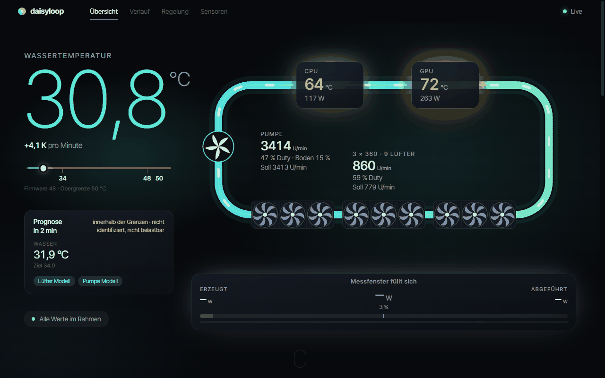
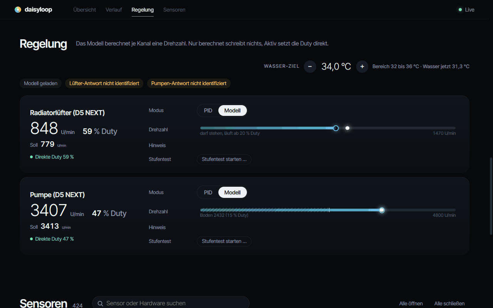
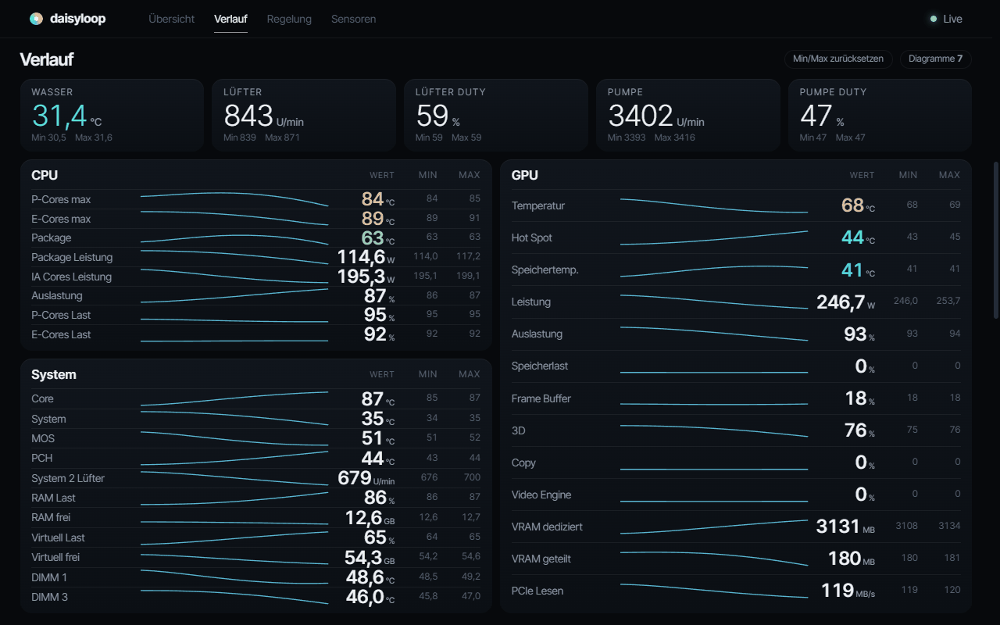
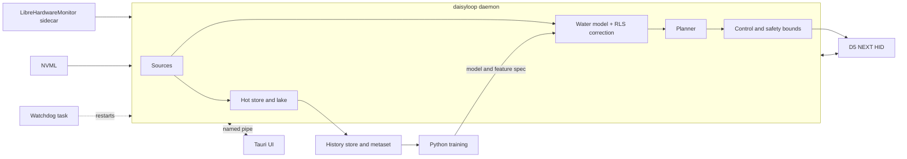

# daisyloop

daisyloop is a Windows daemon with a desktop UI for a PC with an Aqua Computer D5 NEXT water loop. It monitors the sensors of the machine through LibreHardwareMonitor and Aqua Computer HID devices and controls pump and radiator fans with a learned water-temperature model.

The UI is in German. Code and documentation are in English.

## Features

- Sensor monitoring: LibreHardwareMonitor (through a supervised .NET sidecar), NVML and the D5 NEXT HID reports, one row per second.
- Water-temperature control: a learned model forecasts the water temperature and a planner picks fan and pump set points so the water stays at or below the water target (32 to 36 C, set in the UI). Only the water is forecast and planned, there are no CPU or GPU temperature targets.
- Online RLS correction of the forecast per horizon, with bounds, forgetting and a drift alarm.
- Two modes per channel: `PID` (the device firmware drives, daisyloop computes in the background) and `Modell` (daisyloop drives). The choice survives restarts.
- Firmware fallback: on stale inputs, faults or water above the limit the channels go back to the firmware control.
- Sidecar robust to disk load: fast and slow sensor groups, supervised restart with backoff.
- Storage: hot Arrow IPC files, cold Parquet in Iceberg, DuckDB as engine ([docs/lakehouse.md](docs/lakehouse.md)). A daily history store compresses all channels and builds the metaset, a stratified and weighted training subset.
- Desktop UI (Tauri 2): overview, control, history and sensors, tray icon, local named-pipe protocol ([ui/PROTOCOL.md](ui/PROTOCOL.md)).

| Control | History |
| --- | --- |
|  |  |

The screenshots come from the development mock (`ui/web/dev`), from a recorded, anonymised development snapshot.

## Architecture

- `src/`: Rust daemon (sources, stores, model, correction, planner, control, IPC).
- `sidecar/`: C# sidecar exposing LibreHardwareMonitor readings.
- `ui/`: Tauri UI, web front end in `ui/web`, mock daemon in `ui/src/bin/mock.rs`.
- `python/`: training and analysis (`steptrain.py`, `steprun.py`, `stepsim.py`, `metastore.py`, `metaset.py`).
- `tools/model_infer`: Rust inference crate for the exported model. `tools/d5_probe`: D5 NEXT HID probe and abort tools.
- `models/`: deployed model, feature spec and golden test vectors. `docs/`: see [docs/README.md](docs/README.md).

## Safety

The daemon writes HID reports to a pump and fan controller. Writes are off by default and the security-relevant configuration is admin-only. Read [SECURITY.md](SECURITY.md) before enabling writes.

## Requirements

- Windows 11, .NET 8 SDK for the sidecar build (`sidecar/build.ps1` installs it if missing; LibreHardwareMonitorLib comes as a NuGet package)
- Aqua Computer D5 NEXT (USB 0C70:F00E)
- Rust (stable, MSVC), .NET 8 SDK (installed by `sidecar/build.ps1` if missing)
- Python 3.12 with `python/requirements.txt` for the history store, training and tests (`steprun.py` also needs PyTorch for its GPU load generator)

## Build and install

1. `cargo build --release`
2. `sidecar/build.ps1`
3. Elevated PowerShell: `scripts/install-service.ps1`. It installs to `%ProgramFiles%\daisyloop`, registers a watchdog task running as SYSTEM and verifies the new collector before removing the old setup.
4. UI: `cd ui && cargo build --release`.

Tests: `cargo test --release` in the repository root, in `tools/model_infer`, in `tools/d5_probe` and `cd python && python -m pytest`.

## Configuration

`%ProgramFiles%\daisyloop\config.toml` (writable by administrators only) holds the security-relevant keys; the user config in the data dir cannot override them.

| Key | Meaning | Default |
| --- | --- | --- |
| `writes_enabled` | Allow HID writes to the D5 NEXT. Admin only. | `false` |
| `data_dir` | Data and state location. Admin only. | `%LOCALAPPDATA%\daisyloop` (env `DAISYLOOP_DATA_DIR` in development) |
| `sidecar` | Path of the LibreHardwareMonitor sidecar. Admin only. | none |
| `interval_secs` | Sampling interval. Admin only. | `1.0` |
| `ipc_enabled`, `d5_vid`, `d5_pid`, `d5_usage_page` | UI pipe and device selection. Admin only. | on, `0C70`, `F00E`, `FF00` |
| `keep_versions`, `commit_secs`, `wal_max_bytes` | Lake retention and commit cadence. | `10`, `3600`, 2 GiB |
| `[control] water_target`, `target_min`, `target_max` | Default water target and allowed range in C. Admin only. | `34`, `32`, `36` |
| `[control] water_limit` | Above this the firmware takes over. Admin only. | `48` |
| `[control.fan]`, `[control.pump]` | Per-channel overrides such as floors and `autostart_active`. Admin only. | see `src/control.rs` |

## Training workflow

The shipped models were fitted on one loop and do not apply to other hardware.

1. Record a supervised step test with `python/steprun.py` ([docs/steptest.md](docs/steptest.md)).
2. Build or update the history store and the metaset (`python/metastore.py`, `python/metaset.py`).
3. Train on the metaset with `python/steptrain.py`. The gate decides whether the fan and pump response is identified and writes `model_deploy.json` plus `feature_spec_deploy.json`.
4. Deploy the model pair and check it with the golden tests in `tools/model_infer`.

## Project status

Personal project, run on a single machine. Retrain before using it on another system. There is no support for other pump or fan controllers. No warranty.

## License

GPL-3.0-or-later, see [LICENSE](LICENSE). Third-party assets keep their own licenses (for example `ui/web/fonts/OFL.txt`).
